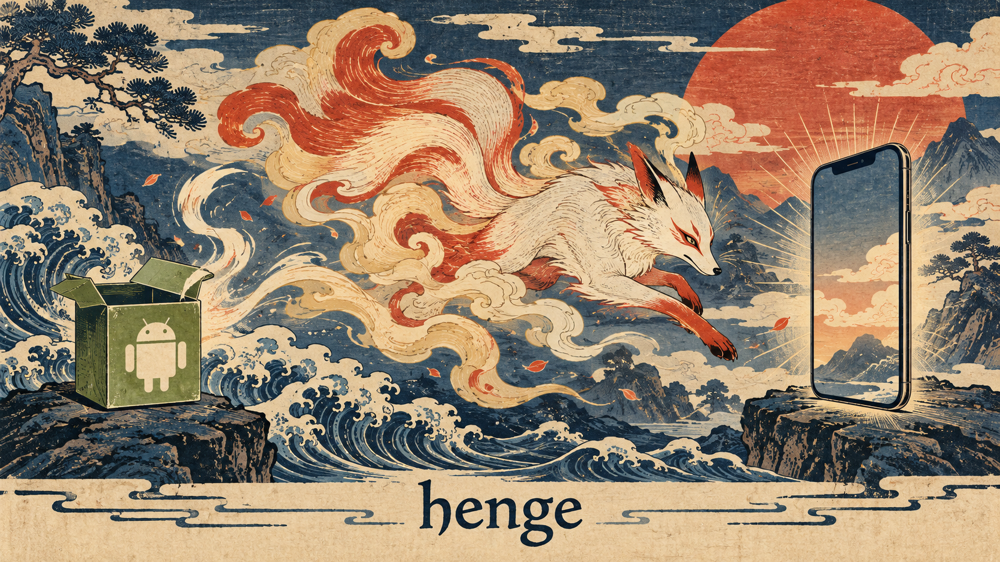

# henge

An experimental project to run the native code of Android apps (APKs) on an iPhone alone.
No JIT, no debugger, no jailbreak: henge **converts the APK to Mach-O on the iPhone, signs it with your own certificate, and loads it**.

Design: [docs/architecture.md](docs/architecture.md)

## Approach

- **Ahead-of-time conversion (AOT)**: Android and iPhone are both ARM64, so machine code is not translated. Repacking the ELF as Mach-O and signing it is enough to run it as signed native code.
- **On-device**: Conversion, signing, and loading all happen inside a host app on the iPhone. Users do not need a Mac (development requires Xcode).
- **Container model**: Like LiveContainer, the host app `dlopen`s the converted dylibs. No per-app reinstall is needed.
- **Narrow scope**: Start with native games that do not use Java (NativeActivity / SDL2 / Godot, etc.). ART (Java/Kotlin) support comes later.

## Design docs

| Path | Contents |
| --- | --- |
| [docs/architecture.md](docs/architecture.md) | Overall design, components, runtime flow |
| [docs/m1-elf-to-macho.md](docs/m1-elf-to-macho.md) | M1: detailed design of ELF → Mach-O conversion and the mini linker |
| [docs/roadmap.md](docs/roadmap.md) | Milestones, exit criteria, items to verify |

## Research

| Path | Contents |
| --- | --- |
| [research/abi-differences.md](research/abi-differences.md) | Differences between Android (AAPCS64 / bionic) and Darwin arm64, and how to handle them |
| [research/prior-art.md](research/prior-art.md) | Prior projects and how henge differs |

## Planned layout

There is no code yet. M1 will create the following structure.

| Path | Contents |
| --- | --- |
| `convert/` | ELF → Mach-O converter (C, no dependencies; testable on macOS too) |
| `runtime/` | Mini linker, bionic compatibility shim, Android API shim (C) |
| `app/` | iOS host app (SwiftUI): APK import, conversion, signing, launch |
| `samples/` | Test `.so` files built with the NDK |
| `tests/` | Tests for the converter and mini linker (run on macOS) |

## Notes

- Try it with `.so` files you built yourself, or with open-source / free APKs.
- Do not distribute converted commercial apps. Circumventing DRM is not a goal.

## Credits

- The Android robot in [docs/images/hero.png](docs/images/hero.png) is reproduced or modified from work created and shared by Google and used according to terms described in the [Creative Commons 3.0 Attribution License](https://creativecommons.org/licenses/by/3.0/).
