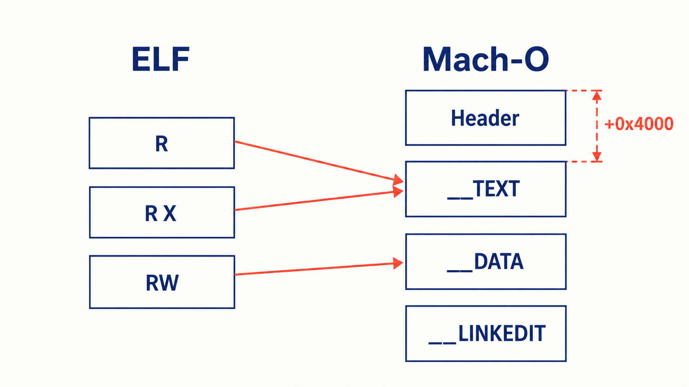

# M1: ELF → Mach-O conversion and the mini linker

M1 goal: convert `libadd.so` (built with the NDK, containing only `int add(int, int)`), call it from the
host app on an iPhone, and show the result on screen. Confirm that **neither JIT nor a debugger is used**.

## 1. Input assumptions

- ELF64, `EM_AARCH64`, `ET_DYN`
- Linked with `-Wl,-z,max-page-size=16384` (16 KiB is the default since NDK r27)
- No `DT_TEXTREL`

The test `.so` is built by us, so M1 can satisfy these assumptions.

## 2. Typical ELF layout

```
vaddr
0x00000  PT_LOAD  R    .dynsym .dynstr .gnu.hash .rela.dyn .rodata ...
0x04000  PT_LOAD  R X  .text .plt
0x08000  PT_LOAD  RW   .data.rel.ro .dynamic .got .got.plt   ← PT_GNU_RELRO
0x0C000  PT_LOAD  RW   .data .bss
```

(When linked with 16 KiB alignment, each `PT_LOAD` starts at a multiple of 0x4000.)

In practice, NDK r29 (lld) merges R and RX into a single `R E` `PT_LOAD` at vaddr 0, and the RW `PT_LOAD`s are not 16 KiB-aligned (e.g. 0x4820 and 0x8a40 for `libadd.so`). They still start on a different 16 KiB page from the code, which is all the converter needs.

## 3. Output Mach-O layout



```
vmaddr (relative within the dylib)
0x00000  __TEXT      r-x   Mach-O header and load commands (16 KiB reserved)
0x04000                    ELF R and RX segments (vaddr + 0x4000)
0x0C000  __DATA      rw-   ELF RW segments (vaddr + 0x4000); vmsize > filesize for bss
0x14000  __LINKEDIT  r--   Symbol table, string table, code signature
```

- **Shift everything by `H = 0x4000`.** ELF vaddr `V` becomes Mach-O vmaddr `V + H`.
  Because `H` is a multiple of 4 KiB, `adrp` (4 KiB page-relative) results do not change.
- `__TEXT` must start at file offset 0 (it contains the Mach-O header).
- ELF R and RX are both non-writable, so they go together into `__TEXT` (r-x). Read-only data merely becomes executable, which does not affect behavior.
- The ELF RELRO region (`.data.rel.ro`, `.got`) stays writable in `__DATA` after relocation. M1 does not protect it (ELF makes it read-only after relocation).
- Gaps between adjacent `PT_LOAD`s are zero-filled to preserve relative positions.

### Load commands

| Load command | Contents |
| --- | --- |
| `LC_SEGMENT_64` × 3 | `__TEXT`, `__DATA`, `__LINKEDIT` |
| `LC_ID_DYLIB` | `@rpath/<package>/libadd.dylib` |
| `LC_BUILD_VERSION` | platform = iOS, minos = 16.0 |
| `LC_SYMTAB` / `LC_DYSYMTAB` | Export a single marker symbol, `_henge_image_marker` |
| `LC_DYLD_CHAINED_FIXUPS` | Empty. dyld performs no relocation |
| `LC_UUID` | Derived from the ELF build-id |
| `LC_CODE_SIGNATURE` | Added by the signer. The converter only reserves space in `__LINKEDIT` |

dyld simply loads this dylib as "a blob of data with no dependencies and no fixups".

> **To verify**: whether dyld accepts a dylib with no `LC_LOAD_DYLIB` dependency on libSystem. If not,
> add a nominal dependency on `/usr/lib/libSystem.B.dylib`.

## 4. Conversion steps (henge-convert)

```
1. Read the ELF header, PT_LOAD, and PT_DYNAMIC
2. Check assumptions (arm64, ET_DYN, no TEXTREL, RX and RW on separate 16 KiB pages)
3. Scan the code and apply patches
     svc #0            → bl __henge_svc_stub (the converter appends the stub at the end of __TEXT)
     mrs xN, tpidr_el0 → M1 only scans and counts (pending verification results)
     x18 usage         → emit a warning
4. Assemble the Mach-O (§3)
5. Write a manifest (original ELF info, H, NEEDED, list of patches) → manifest.json
```

`bl` reaches ±128 MiB. Larger `.so` files are not handled in M1.

## 5. Mini linker

After `dlopen`, the host app calls `henge_link(path)`.

```
1. Find the image whose path matches using _dyld_image_count / _dyld_get_image_name,
   and get its header address
2. base = header + H          (the address corresponding to ELF vaddr 0)
3. Read .dynamic from base + PT_DYNAMIC vaddr
4. Load DT_NEEDED first (in M1 only libc.so, backed by the shim)
5. Process relocations
6. Call DT_INIT → DT_INIT_ARRAY
7. henge_dlsym(handle, "add") looks up .dynsym via DT_GNU_HASH
```

### Relocation types handled

| Type | Value | Action |
| --- | --- | --- |
| `R_AARCH64_RELATIVE` | 1027 | `*P = base + A` |
| `R_AARCH64_GLOB_DAT` | 1025 | `*P = S + A` |
| `R_AARCH64_JUMP_SLOT` | 1026 | `*P = S` (no lazy binding; everything is resolved immediately) |
| `R_AARCH64_ABS64` | 257 | `*P = S + A` |
| `R_AARCH64_TLS_TPREL64` | 1030 | M2 |
| `R_AARCH64_TLSDESC` | 1031 | M2 |
| `R_AARCH64_IRELATIVE` | 1032 | M2 (call the ifunc resolver) |

Relocation table formats:

| Format | Dynamic tag | When |
| --- | --- | --- |
| Plain RELA | `DT_RELA` / `DT_JMPREL` | M1 |
| RELR | `DT_RELR` (Android API 28+, used by the NDK) | M1 |
| Android packed relocations (APS2) | `DT_ANDROID_RELA` | M2 |

Check that every write target `P` falls within `__DATA`; abort loading if one does not.

## 6. Signing

In M1 it is fine to use `codesign` on a Mac (bundled into the app by the Xcode build). On-device signing comes in M2.

| Stage | dylib location | Signing |
| --- | --- | --- |
| M1a | Inside the app bundle (`Frameworks/`) | Signed by Xcode |
| M1b | Copied to the container's `Library/` | Copy a Mac-signed dylib (confirms `dlopen` from the container) |
| M2 | The container's `Library/` | Signed on the iPhone |

## 7. Exit criteria

- [ ] `libadd.so` can be converted with `henge-convert`
- [ ] Tests on macOS confirm the converted dylib's layout (shift by H, segment permissions)
- [ ] On the iPhone, `dlopen` → `henge_link` → `add(2, 3)` returns 5
- [ ] Functions that reference global variables (via `adrp` + GOT) also work correctly
- [ ] It still works when launched with the Xcode debugger detached (confirms no JIT is used)
